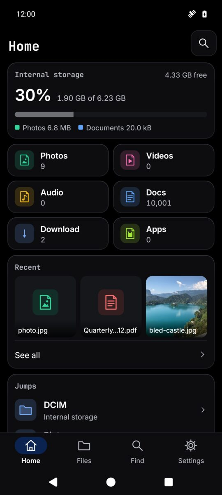

  

<h1 align="center">Fileglow</h1>

A private, reliable, simple file manager for Android phones, tablets and TVs. It never writes over a file. Undo, trash, no ads.

  <a href="https://play.google.com/store/apps/details?id=com.zanoshky.fileglow"><b>Google Play</b></a> ·
  <a href="https://fileglow.zanoski.com"><b>fileglow.zanoski.com</b></a> ·
  <a href="https://zanoshky.github.io/fileglow-app/"><b>User guide</b></a> ·
  <a href="https://github.com/Zanoshky/fileglow-app/issues/new/choose"><b>Report a bug</b></a>

  

This repo is the public home for Fileglow users: the user guide, bug reports and feature requests. The app itself is not open source and its code is not here.

## Quick start

1. Install Fileglow from Google Play. It runs on Android 7 or newer, and on Android TV and Google TV.
2. Allow All files access when Fileglow asks, so it can show, copy, move and delete your files.
3. Home shows your storage, what fills it, recent files and the folders you open most.
4. Open Files, touch and hold a row to pick files, then copy, move, rename, zip or move them to the trash. Undo brings them back.
5. Find, in the bar, jumps to any folder or file by a few letters of its name.
6. Pro, one optional payment, adds network shares, Dropbox, Wi-Fi transfer, the vault, Sort photos and more.

## The guide

| Page | What is in it |
| --- | --- |
| [Guide](https://zanoshky.github.io/fileglow-app/guide.html) | Home, Files, Find, the file safety promise, Pro, Settings and Android TV |
| [Questions](https://zanoshky.github.io/fileglow-app/faq.html) | Answers and fixes for common problems |
| [Report a bug](https://zanoshky.github.io/fileglow-app/report.html) | What to include in a good report |

The guide pages are plain HTML in [docs](docs), built by `python3 build.py`.

## Report a bug or ask for a feature

1. Search the [open issues](https://github.com/Zanoshky/fileglow-app/issues) first. If yours is there, add a thumbs up or a comment.
2. Otherwise open a [bug report](https://github.com/Zanoshky/fileglow-app/issues/new?template=bug_report.yml) or a [feature request](https://github.com/Zanoshky/fileglow-app/issues/new?template=feature_request.yml).
3. Add your app version, device model and Android version, and a screenshot if you can. Crop out anything private first: issues are public.

Prefer email? Write to support@zanoski.com.

## License

The guide text and images in this repo are shared under [CC BY 4.0](LICENSE). The Fileglow app itself is proprietary and is not covered by this license.
